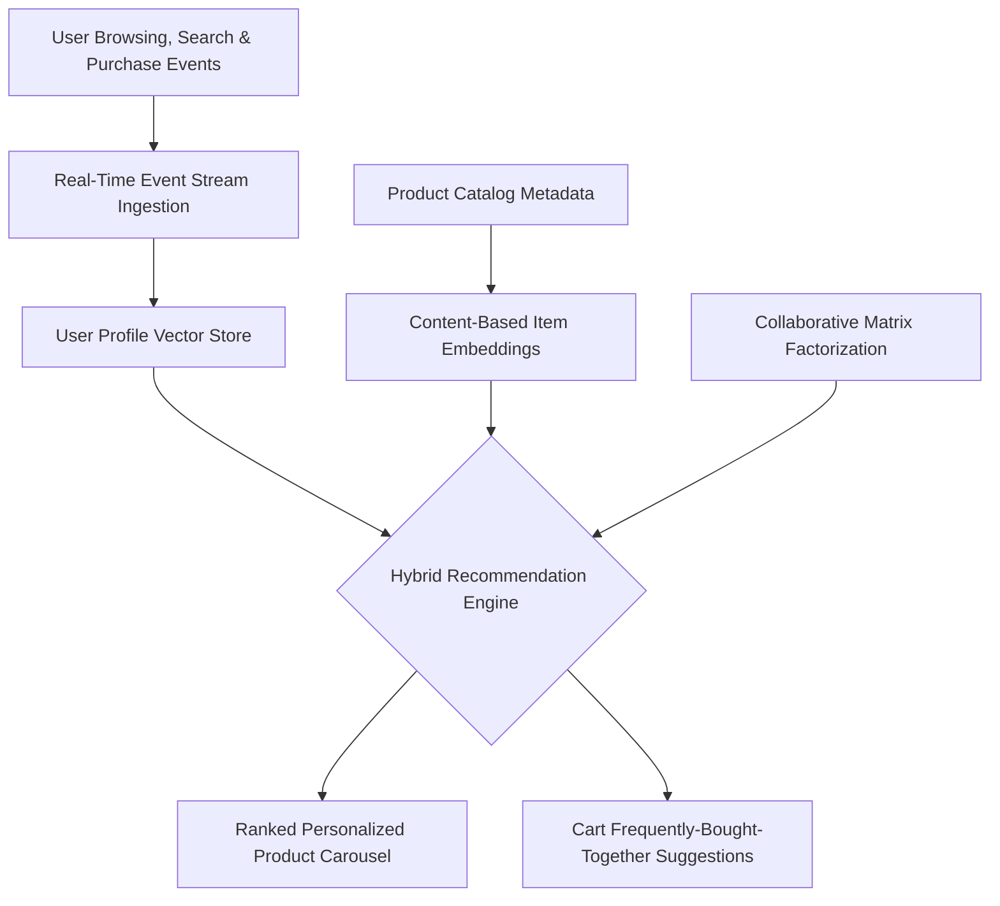

<div align="center">

  <!-- NATIVE ANIMATED CYBER BANNER -->
  

  <br/>

  <!-- ANIMATED TYPING SVG -->
  

  <br/>

  <!-- TECH BADGES -->
  <p align="center">
    
    
    
    
    
  </p>

</div>

---

### 🌟 System Overview

**Personalized Recommendation Engine for E-Commerce** is an algorithmic recommendation suite that models user browsing behavior, cart additions, and past purchase history to deliver real-time personalized product feeds, decreasing bounce rates and boosting checkout conversion.

---

### 🔬 Operational Architecture & Data Pipeline Flow



---

### 🚀 Key Capabilities & Features

- **🔄 Hybrid Recommendation Model:** Merges collaborative matrix filtering with content-based attribute matching.
- **🛒 Real-Time Cart Upsell:** Generates 'Frequently Bought Together' bundles based on historical basket co-occurrence.
- **📊 Cold-Start Handling:** Leverages trending items and demographic category defaults for new unauthenticated visitors.
- **⚡ High-Throughput REST Endpoints:** Sub-20ms JSON response times for low-latency frontend injection.

---

### ⚡ Quickstart & Execution

```bash
# 1. Clone & enter
git clone https://github.com/Akshay-Notfound/Personalize-Recommend-Engine-Using-E-Commerce.git
cd Personalize-Recommend-Engine-Using-E-Commerce

# 2. Install dependencies & run
npm install
npm start
```

---

### 👤 Author & Architecture

**Akshay Shivaji Rathod**  
*Data & AI Engineer*  
* 🌐 **Portfolio:** [akshay-notfound.vercel.app](https://akshay-notfound.vercel.app)  
* 💼 **LinkedIn:** [linkedin.com/in/akshay-rathod-aaab52206](https://www.linkedin.com/in/akshay-rathod-aaab52206/)  
* 🐙 **GitHub:** [@Akshay-Notfound](https://github.com/Akshay-Notfound)  

---

<div align="center">
  <sub>Licensed under the MIT License. Designed for scalability, intelligence, and performance.</sub>
</div>
